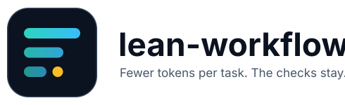

<p align="center">
  
</p>

<p align="center">
  A Claude Code plugin that keeps sessions cheap and repeatable: guards against the usual token sinks,
  a code map and start-of-session script so work begins at the right file, one command that runs the
  repo's own checks, and a retro that changes a rule only when the numbers repeat.
</p>

<p align="center">
  <a href="https://github.com/Braydenh563/lean-workflow/actions/workflows/ci.yml"></a>
  
  <a href="LICENSE"></a>
  
</p>

<p align="center">
  <a href="#install"></a>
  <a href="#what-it-does"></a>
  <a href="#what-lean-setup-adds-to-a-repo"></a>
  <a href="#configuration"></a>
  <a href="#status-and-limits"></a>
</p>

---

## Why

Claude Code's cost is turns multiplied by context. Most of the avoidable spend comes from a few
habits: reading a 5,000-line file whole, repeating a failing call, handing an agent the wrong model,
and carrying a 150k-token context long past the point where a fresh session would be cheaper. This
plugin catches those at the moment they happen and keeps the project's state in files, so a new
session starts from a short note instead of re-exploring.

It came out of [Tessellate](https://github.com/Braydenh563/Tessellate), where the same rules run
daily across long sessions with several agents.

## Install

```
/plugin install lean-workflow --marketplace Braydenh563/lean-workflow
```

Then open any repo. The first time, the plugin tells Claude to run `lean-setup`, which adds the
files below. A repo that already has the workflow is left alone.

## What it does

### Guards (always on)

| Guard | Trigger | Effect |
| --- | --- | --- |
| Huge-file read | Whole-file `Read` of a path matching `grepOnly` (code maps, histories, lockfiles, minified files) | Denied; grep, then read a line range |
| Repeat loop | The same tool call three times in a row | Denied; change the hypothesis or report the blocker |
| Unnamed agent | `Agent` call with no model (agent types that pin their own are exempt) | Denied; name haiku, sonnet or opus |
| Unrequested Fable | A Fable agent when your prompt did not name it | Denied |

### Warnings

- Context per turn in the status line; a note once it passes 150k.
- A cold prompt cache after 55 idle minutes.
- Images in a prompt and any tool result over 20,000 characters, since both ride in context on every later turn.
- `CLAUDE.md` over 200 lines, `.claude/now.md` over 60 lines or at 20 inbox items.

### Commands

| Command | Shows |
| --- | --- |
| `/spend` | This session's cost split by model and token type, against your own median, with one next step |
| `/dash` | Context bar, agents, tasks and cost by model (a pane where the surface has one, text otherwise) |
| `/prune` | Plugins you have not used across the sessions recorded (after five) |

### Skills and agents

- `lean-setup` installs the files in the next section.
- `retro` measures the session, appends one ledger line and changes at most one rule, and only when the same signal appears in two or more lines.
- Agents: `scout` (read-only finder, Haiku), `reviewer` (independent diff check), `ux-auditor`, `blind-tester`.

## What `lean-setup` adds to a repo

| File | Purpose |
| --- | --- |
| `CLAUDE.md` section "Lean workflow" | Model rungs, tiers, the Fable opt-in rule, retry limit, and the working rules below |
| `.claude/now.md` | Goal, current state, active files, changes, failed attempts, next steps, **Decisions** (written once, not remade) and **Inbox** (mid-task requests recorded word for word, triaged at the next step boundary, under 20) |
| `.claude/retro-ledger.md` | One line per session; the evidence the retro works from |
| `scripts/codemap.py` | Writes `docs/CODEMAP.md`: `name \| file:line` for Python, JS/TS and Go definitions, plus test files with counts. `--check` exits 1 when the map is stale |
| `scripts/orient.sh` | Under 40 lines of shell: head of `now.md`, inbox and decision counts, uncommitted paths, remaining-work files, map freshness, last ledger line |
| `scripts/gate.sh` | Filled from your CI config. Plain run: fast checks. `--changed`: plus tests that name changed files. `--staged`: checks against the index, so a commit that splits a pair is caught. `--full`: the whole suite. Always ends with the map check |

An existing 1.0 repo gets the new pieces by saying "lean upgrade".

### Working rules it writes

- Run `scripts/orient.sh` first, `scripts/gate.sh` before every push.
- Grep `docs/CODEMAP.md`, then read line ranges. Scouts do the same.
- Agents keep `.claude/remaining/<agent>.md` (done, next, blocked) and commit at least every 20 minutes, so a usage limit never loses work.
- Tests take a fixed "now" (an injected or frozen clock), never the real one.
- A claim about how a UI looks or behaves needs a measurement from the running app; say what was not verified.
- One retry per new hypothesis. The builder does not grade its own work.

## Configuration

Set under the plugin's options.

| Option | Default | Meaning |
| --- | --- | --- |
| `grepOnly` | code maps, histories, changelogs, lockfiles, `.min.js`, `.map` | Regex of paths that must not be read whole |
| `claudeMdMaxLines` | 200 | Warn when `CLAUDE.md` is read whole or written past this |
| `nowMaxLines` | 60 | Same for `.claude/now.md` |

## Status and limits

- Usage figures are the plugin's own counts of the session's token usage, weighted by relative price (reads 0.1, input 1, writes 2, output 5). They are ratios for comparison, not plan usage or money.
- The guards and templates are tested (`claude plugin test .`, `pytest tests`). Whether the rules save tokens in your repo is something to read off your own ledger; one session proves nothing, which is why `retro` waits for repeats.
- `codemap.py` reads Python with `ast` and JS/TS/Go with regular expressions, so it can miss unusual declaration styles. It maps top-level and exported definitions only.
- `gate.sh` runs whatever your CI runs; it cannot know a check CI does not.

## Develop

```
claude plugin test .       # hook tests
claude plugin validate .   # manifest
python -m pytest tests     # template tests, in a scratch repo
```

Layout: `hooks/` (guards, commands, formatting), `skills/` (`lean-setup` with `templates/`, `retro`), `agents/`, `.claude-plugin/` (manifests).

## Licence

[MIT](LICENSE)
